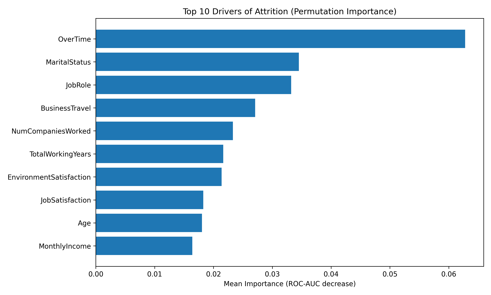

# Employee Attrition Analysis Using Basic Machine Learning Algorithm

# Overview
This project builds an end-to-end machine learning workflow to identify the main drivers of employee attrition using an HR analytics dataset.

# Business need of the project
To find which workforce factors are most associated with attrition, and to build a simple model that flags higher-risk employees to support them and aid retention.

# Contents
- data cleaning for HR compensation fields
- preprocessing pipeline for numeric and categorical features
- logistic regression classification
- ROC-AUC evaluation
- permutation-based feature importance
- recruiter-friendly visual outputs

# Performance Measures

## ROC Curve

## Top Attrition Drivers

## Attrition vs Overtime

