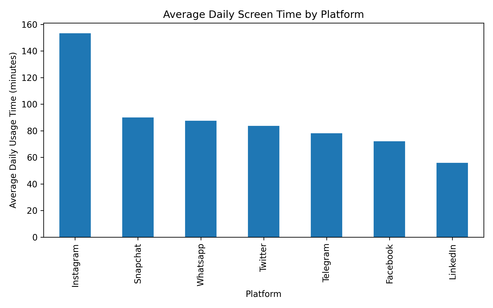
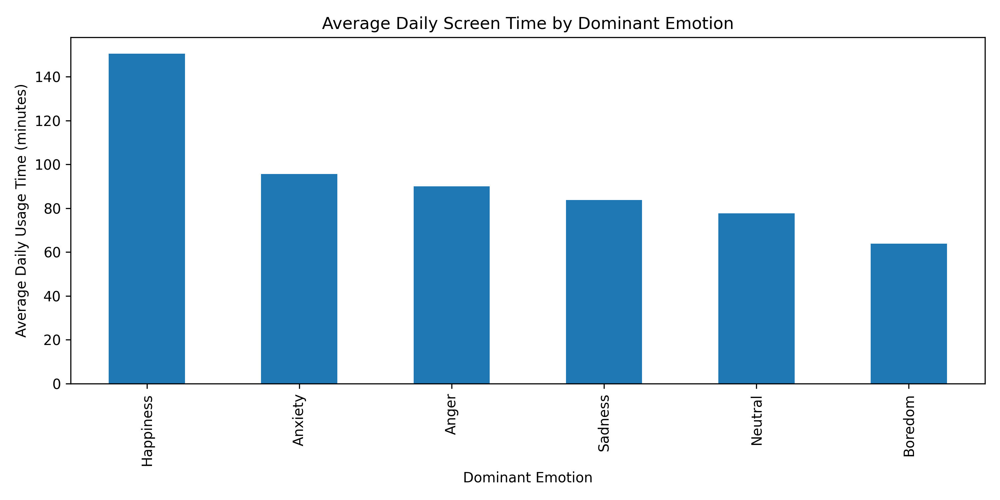

# Screen Time and Emotional Well-Being Analysis

# Overview
This project studies the relationship between social media screen time and emotional well-being using regression-based statistical modelling in Python.

# Business Needs
To find how daily screen time, platform choice, and engagement behaviour relates to emotional well-being indicators affecting personal and business (social media engagement methods) aspects.

# Contents
- cleaned Excel-based social media dataset
- descriptive visualizations
- logistic regression for happiness-related outcome
- linear regression for daily usage time
- coefficient tables and recruiter-friendly visual outputs

# Model Performance outputs(Visuals)

## Average Screen Time by Platform

## Average Screen Time by Emotion

## Regression Coefficient Plot

