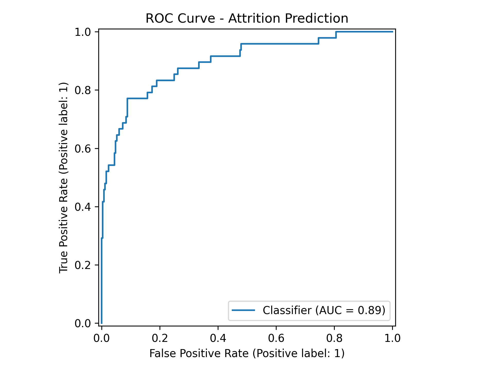
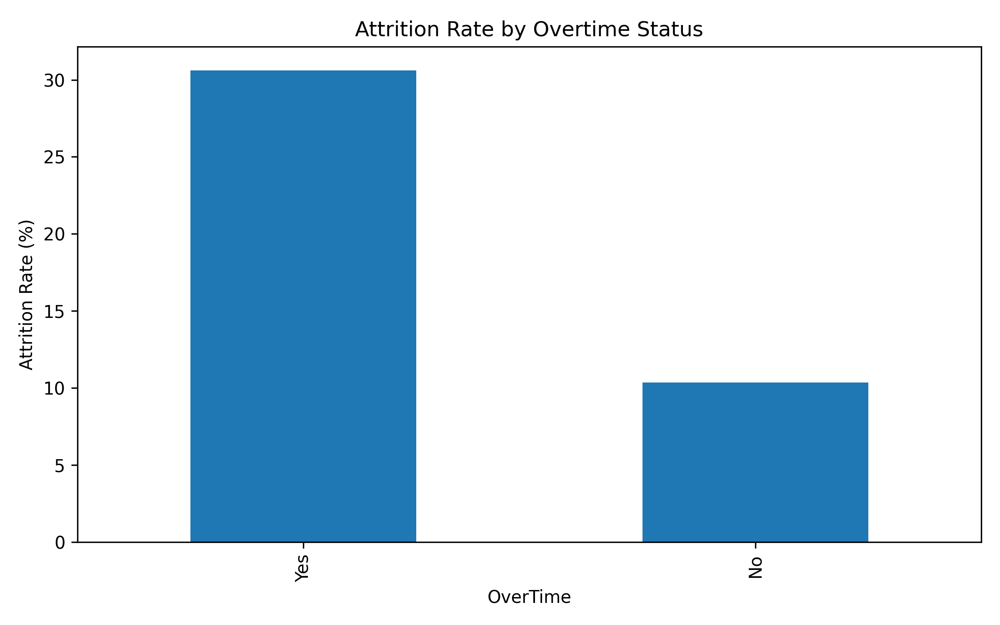

# Employee Attrition Analysis Using Machine Learning

## Overview
This project builds an end-to-end machine learning workflow to identify the main drivers of employee attrition using an HR analytics dataset.

## Business Question
Which workforce factors are most associated with attrition, and can we build a model that flags higher-risk employees?

## What This Project Includes
- data cleaning for HR compensation fields
- preprocessing pipeline for numeric and categorical features
- logistic regression classification
- ROC-AUC evaluation
- permutation-based feature importance
- recruiter-friendly visual outputs

## Key Visuals

### ROC Curve


### Top Attrition Drivers


### Attrition vs Overtime


## Project Structure
```text
attrition-analysis-ml/
├── data/raw/HR Analysis Dataset.csv
├── notebooks/attrition_analysis_end_to_end.ipynb
├── outputs/
│   ├── figures/
│   └── tables/
├── src/attrition_analysis.py
├── README.md
└── requirements.txt
```

## How to Run
```bash
pip install -r requirements.txt
python src/attrition_analysis.py
```

## Outputs
The script writes:
- `outputs/figures/roc_curve.png`
- `outputs/figures/top_10_attrition_drivers.png`
- `outputs/figures/attrition_rate_by_overtime.png`
- `outputs/figures/median_income_by_attrition.png`
- `outputs/tables/feature_importance.csv`
- `outputs/tables/model_summary.json`

## Skills Demonstrated
Python, Pandas, scikit-learn, classification modelling, feature analysis, business interpretation
