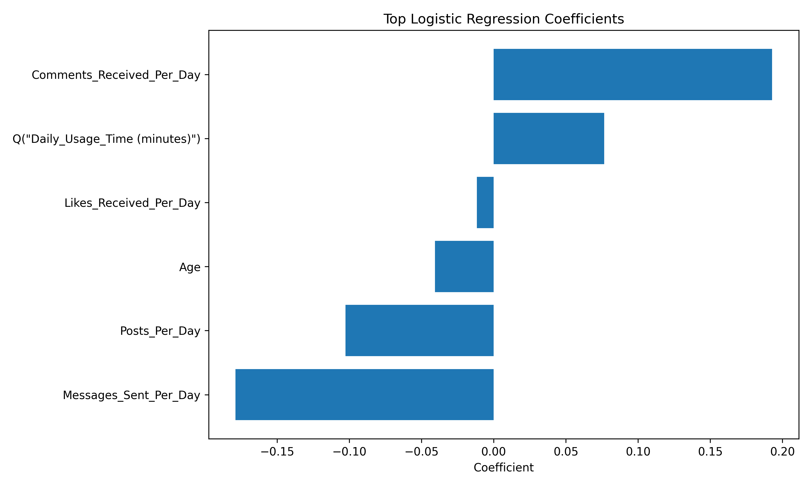

# Screen Time and Emotional Well-Being Analysis

## Overview
This project studies the relationship between social media screen time and emotional well-being using regression-based statistical modelling in Python.

## Research Question
How do daily screen time, platform choice, and engagement behaviour relate to emotional well-being indicators?

## What This Project Includes
- cleaned Excel-based social media dataset
- descriptive visualizations
- logistic regression for happiness-related outcome
- linear regression for daily usage time
- coefficient tables and recruiter-friendly visual outputs

## Key Visuals

### Average Screen Time by Platform


### Average Screen Time by Emotion


### Regression Coefficient Plot


## Project Structure
```text
screen-time-wellbeing-analysis/
├── data/raw/Social Media Emotions Analysis.xlsx
├── notebooks/screen_time_emotional_wellbeing.ipynb
├── outputs/
│   ├── figures/
│   └── tables/
├── src/screen_time_wellbeing_analysis.py
├── README.md
└── requirements.txt
```

## How to Run
```bash
pip install -r requirements.txt
python src/screen_time_wellbeing_analysis.py
```

## Outputs
The script writes:
- `outputs/figures/avg_screen_time_by_platform.png`
- `outputs/figures/avg_screen_time_by_emotion.png`
- `outputs/figures/regression_coefficient_plot.png`
- `outputs/figures/linear_regression_coefficient_plot.png`
- `outputs/tables/logistic_coefficients.csv`
- `outputs/tables/linear_coefficients.csv`
- `outputs/tables/model_summary.json`

## Skills Demonstrated
Python, Pandas, statsmodels, scikit-learn, regression analysis, hypothesis interpretation, data visualization
